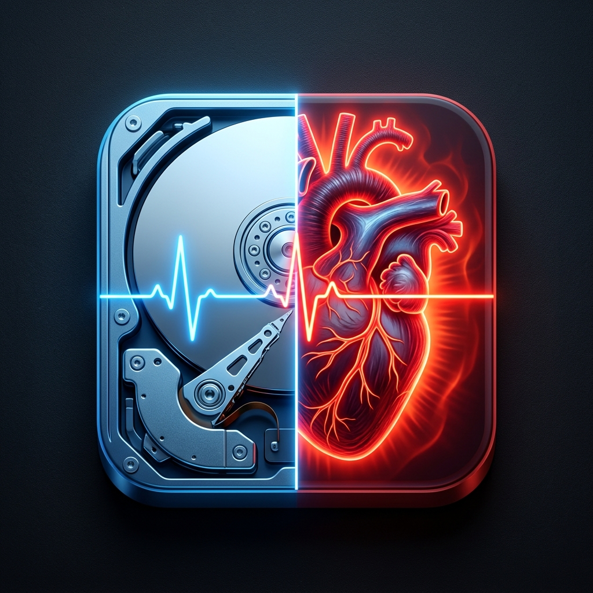

# 💽 HDDKeepAlive

<p align="center">
  
</p>

**🌐 English** | [🇨🇳 简体中文](README_zh.md)

A lightweight, silent Windows system tray utility designed to prevent external mechanical hard drives (HDDs) from automatically spinning down or entering sleep mode.

Zero external dependencies, single-file native executable (~28 KB), adaptive USB storage auto-discovery, and real-time PnP hot-plug detection.

---

## ⚡ Why HDDKeepAlive? (Comparison with Existing Tools)

While tools like *KeepAliveHD*, *DiskNotSleep*, or manual Task Scheduler scripts exist, most were built over a decade ago and require tedious manual configuration. **HDDKeepAlive** was built from scratch to address their long-standing limitations:

| Feature / Capability | Traditional Tools (e.g. KeepAliveHD, DiskNotSleep) | **💽 HDDKeepAlive** |
| :--- | :--- | :--- |
| **🔍 Drive Discovery** | ❌ **Manual**: User must manually browse and bind drive letters or folders | ✅ **100% Automatic**: Win32 kernel IOCTL queries hardware `BusType == 7 (USB)` directly |
| **🔌 PnP Hot-Plug Detection** | ❌ **None**: Changing USB ports or plugging new drives requires restarting/reconfiguring | ✅ **Real-Time**: Intercepts Windows `WM_DEVICECHANGE` broadcasts; adapts within 1.5s |
| **🛡️ Internal SSD Protection** | ❌ **None**: Inexperienced users may select internal NVMe/SATA SSDs, causing unnecessary write wear | ✅ **Hardware-Level Guard**: Automatically ignores internal NVMe, SATA SSDs, and system drive `C:\` |
| **⚡ Cache Bypass Mechanism** | ⚠️ Standard `WriteAllText` (can be buffered by Windows Write Cache; risks "Delayed Write Failed") | ✅ Strict `FileStream.Flush(true)` bypasses OS cache directly to hardware controller |
| **📦 Packaging & Size** | ⚠️ Multi-file installer or heavy frameworks (~several MBs, configuration windows) | ✅ **28 KB single standalone executable**, zero runtime dependencies, silent in tray |
| **🌐 UI & Localization** | ⚠️ Monolingual English | ✅ **Bilingual**: Instant live toggle between **English** and **简体中文** |

---

## 🛑 Background & Problem

1. **⏱️ Spin-down Latency**: External 3.5" and 2.5" mechanical hard drives (enclosures, docking stations, multi-bay DAS storage) frequently spin down their spindle motors after a few minutes of inactivity due to aggressive disk firmware or Windows APM (Advanced Power Management) policies. When accessing files again, users experience a 3-8 second freeze while the drive spins back up.
2. **⚙️ Drive Wear & Tear**: Mechanical drives experience the highest physical wear during spindle spin-up and head park/unpark transitions (Load/Unload cycles). Excessive cycling degrades drive longevity.
3. **⚠️ Shortcomings of Existing Solutions**:
   - Heavy runtimes (Python, Node.js, Electron wrappers).
   - Hardcoded drive letters (`E:`, `F:`) that break when plugging drives into different ports or machines.
   - Indiscriminate writes to internal NVMe/SATA SSDs, wasting flash write endurance.

---

## ✨ Key Features

- 🌐 **Bilingual Interface (English / 简体中文)**:
  - Automatically selects system UI language (defaults to Chinese on Chinese locales, English elsewhere).
  - One-click live language toggle directly from the system tray menu without restarting.
- 🔌 **Dual-Engine Adaptive Bus Detection (Zero Hardcoding)**:
  - Uses Win32 kernel API `CreateFile` + `DeviceIoControl(IOCTL_STORAGE_QUERY_PROPERTY)` to verify `BusType == 7 (USB)`.
  - Sub-millisecond execution time, requiring zero administrator elevation.
  - Automatically skips internal NVMe (BusType=17) and SATA (BusType=11) solid-state drives, as well as the system partition (`C:\`).
  - Fallback Storage WMI provider (`MSFT_Disk`) for non-standard environments.
- ⚡ **Real-Time PnP Hot-Plug Listening**:
  - Intercepts Windows broadcast messages `WM_DEVICECHANGE` (`0x0219`), dynamically refreshing target drives within 1.5 seconds upon insertion or removal.
- 🛡️ **Minimal Physical Keep-Alive Footprint**:
  - Writes a tiny 19-byte timestamp to a hidden file (`.hdd_keepalive`) in the drive root and invokes `Flush(true)` to pass through the OS file cache directly to disk hardware.
  - Generates less than 50 KB of disk writes per day, causing zero wear.
- 💻 **Native Tray Management & Persistence**:
  - Resides quietly in the system notification area.
  - Displays partition volumes and available capacity (e.g. `[E:] Backup (128.8 GB / 1200.0 GB)`).
  - Allows toggling keep-alive for individual drives and opening drive root in Explorer.
  - Configurable heartbeat intervals (30s, 60s recommended, 120s, 180s), saved automatically to `HKCU\Software\HDDKeepAlive`.
- 📦 **Pure Native Single-File Executable**:
  - Clean C# codebase in a single file (`Program.cs`), compiled for .NET 4.0-4.8 (pre-installed on Windows 7, 8, 10, 11).
  - No installer, no background console window, ~28 KB portable binary.

---

## 🛠️ Building from Source

### Method 1: Using Built-in Windows C# Compiler (No Visual Studio Required)

Double-click `build.bat` or run:

```cmd
%windir%\Microsoft.NET\Framework64\v4.0.30319\csc.exe /target:winexe /optimize+ /r:System.Drawing.dll,System.Windows.Forms.dll,System.Management.dll /out:HDDKeepAlive.exe Program.cs
```

### Method 2: Using MSBuild or Visual Studio

```cmd
msbuild HDDKeepAlive.csproj /p:Configuration=Release
```

---

## 🚀 Getting Started

1. Download `HDDKeepAlive.exe` from the [Releases page](https://github.com/Kirosca/HDDKeepAlive/releases).
2. Double-click to launch; an HDD icon will appear in the system tray.
3. Plug in any external hard drive; a balloon notification will confirm it is protected.
4. Right-click the tray icon to:
   - 📁 View connected external drives and toggle protection per drive.
   - ⚡ Send an immediate keep-alive heartbeat.
   - ⏱️ Adjust interval (30s, 60s, 120s, 180s).
   - 🌐 Switch language (**English** / **简体中文**).
   - 🚀 Toggle **Start with Windows**.
   - 📊 View running statistics and uptime.

---

## 📄 License

This project is licensed under the [MIT License](LICENSE).
